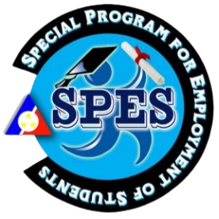
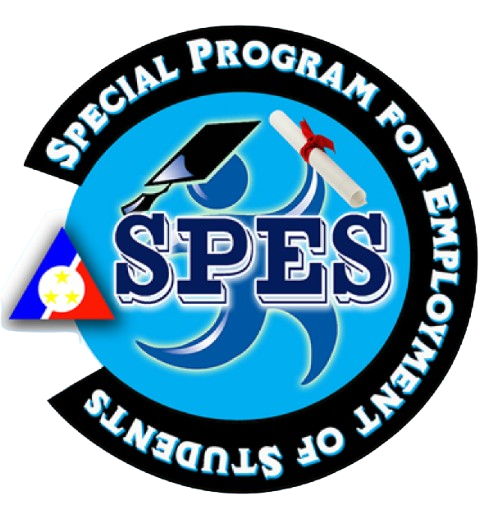
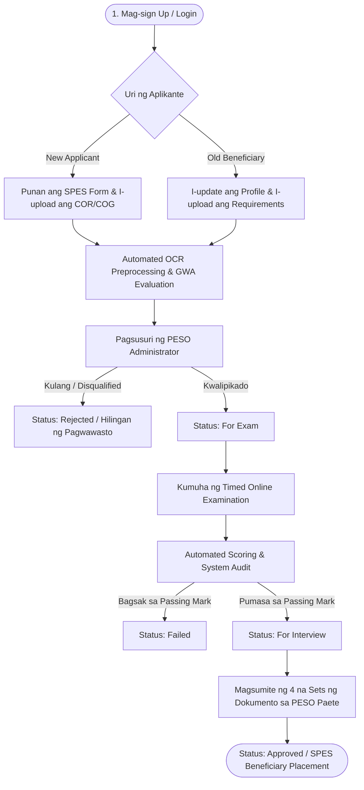

<div align="center">

  
  &nbsp;&nbsp;&nbsp;&nbsp;&nbsp;&nbsp;&nbsp;&nbsp;
  

  # 🎓 DigiSPES
  ### *Digital Portal & Examination Management System for SPES*
  **Public Employment Service Office (PESO) — Municipality of Paete, Laguna**

  <p align="center">
    <em>"A web-based platform for the Special Program for the Employment of Students, making it easier to apply, track your status, receive updates, and connect with PESO — all in one place."</em>
  </p>

  [](https://www.python.org/)
  [](https://flask.palletsprojects.com/)
  [](https://www.mysql.com/)
  [](https://socket.io/)
  [](https://github.com/tesseract-ocr/tesseract)
  [](https://getbootstrap.com/)

  <br />

  

</div>

---

## 📑 Talaan ng Nilalaman / Table of Contents

- [Overview / Tungkol sa Sistema](#-overview--tungkol-sa-sistema)
- [Workflow / Daloy ng Proseso](#-workflow--daloy-ng-proseso)
- [Pangunahing Katangian / Key Features](#-pangunahing-katangian--key-features)
  - [1. Portal ng Aplikante (New & Old SPES Applicants)](#1-portal-ng-aplikante-new--old-spes-applicants)
  - [2. Administrative Management Suite](#2-administrative-management-suite)
  - [3. Online Examination & Scoring Engine](#3-online-examination--scoring-engine)
  - [4. OCR Document Verification Engine](#4-ocr-document-verification-engine)
  - [5. Real-Time Chat & FAQ Chatbot](#5-real-time-chat--faq-chatbot)
- [Tech Stack & Dependencies](#-tech-stack--dependencies)
- [Istruktura ng Proyekto / Directory Structure](#-istruktura-ng-proyekto--directory-structure)
- [Mga Kinakailangan / Prerequisites](#-mga-kinakailangan--prerequisites)
- [Mabilisang Pagsisimula / Quick Start Guide](#-mabilisang-pagsisimula--quick-start-guide)
  - [Hakbang 1: Pag-clone ng Repository](#hakbang-1-pag-clone-ng-repository)
  - [Hakbang 2: Virtual Environment & Packages](#hakbang-2-virtual-environment--packages)
  - [Hakbang 3: Database Setup](#hakbang-3-database-setup)
  - [Hakbang 4: Configuration](#hakbang-4-configuration)
  - [Hakbang 5: Pagpapatakbo ng Application](#hakbang-5-pagpapatakbo-ng-application)
- [Demo Credentials & Mga Account](#-demo-credentials--mga-account)
- [Mga Gabay sa Dokumento / SPES Guidelines (Paete PESO)](#-mga-gabay-sa-dokumento--spes-guidelines-paete-peso)
- [Troubleshooting & Solusyon sa Karaniwang Error](#-troubleshooting--solusyon-sa-karaniwang-error)
- [May-Akda at Pagkilala / Authors & Acknowledgments](#-may-akda-at-pagkilala--authors--acknowledgments)

---

## 📌 Overview / Tungkol sa Sistema

Ang **DigiSPES** ay isang modernong web application na binuo para sa **Public Employment Service Office (PESO)** ng **Bayan ng Paete, Laguna** upang gawing digital, mabilis, at maayos ang pangangasiwa ng **Special Program for Employment of Students (SPES)** ng **Department of Labor and Employment (DOLE)**.

### 🎯 Mga Solusyong Hatid ng DigiSPES:
* ❌ **Wala nang mahabang pila:** Direktang makakapag-rehistro at makakapagpasa online ang mga estudyante.
* 📄 **Digital SPES Forms:** Otomatikong nakakapag-preview at nakakapag-download ng mga opisyal na template (`APPLICATION-FORM.docx`, `OATH-OF-UNDERTAKING.docx`, `SCHOOL-CERTIFICATION.docx`, `SPES-EMPLOYMENT-CONTRACT.docx`).
* 🔍 **OCR-Assisted Grade Checking:** Gumagamit ng Tesseract OCR para suriin ang Certificate of Grades (COG) / Certificate of Registration (COR) at tiyaking walang markang mas mababa sa 80% o 2.75.
* ⏱️ **Online Examination System:** Pagbibigay ng online exam na may timer, automated scoring, at pagtatakda ng mga slot.
* 💬 **Real-Time Support:** Live chat via WebSockets at 24/7 FAQ Chatbot para sa agarang sagot sa mga katanungan ng mga aplikante.

---

## 🔄 Workflow / Daloy ng Proseso



---

## ✨ Pangunahing Katangian / Key Features

### 1. 🎓 Portal ng Aplikante (New & Old SPES Applicants)
* **Nakabukod na Proseso:** May magkahiwalay na dashboard at form para sa mga bagong aplikante (*New*) at mga dati nang benepisyaryo (*Old / SPES Babies*).
* **Komprehensibong Profile:** Madaling pagsagot sa impormasyon ng mag-aaral, edukasyon, pamilya, mga espesyal na kasanayan, at GSIS beneficiary.
* **Document Management:** Mabilis na pag-upload ng PDF ng Certificate of Registration (COR) at Certificate of Grades (COG).
* **Document Generator / Preview:** Live browser preview ng mga opisyal na dokumentong kailangan bago i-print gamit ang `docx2pdf`.
* **Application Status Tracking:** Real-time na pagsubaybay sa katayuan: `Pending` ➔ `For Exam` ➔ `For Interview` ➔ `Approved` / `Rejected`.

### 2. 🛡️ Administrative Management Suite
* **Interactive Dashboard:** Real-time na statistics ng kabuuang bilang ng mga nag-apply, pending na aplikasyon, mga kukuha ng exam, at mga pumasa.
* **Vetting & Approval Pipeline:** Mabilisang pag-apruba, pag-reject, o pag-endorso ng aplikante sa susunod na yugto.
* **Examinee Oversight:** Pagsusuri ng bawat sagot ng examinee kalakip ang opsyon para sa manual score adjustment ng administrator.
* **System Audit Logs (`admin_logs`):** Pagtatala ng bawat aksyon ng admin para sa transparency at seguridad.

### 3. 📝 Online Examination & Scoring Engine
* **Dynamic Exam Creator:** Paglikha ng mga pagsusulit na may sariling time limit, passing percentage (default: 70%), at limitasyon sa slots.
* **Multiple Pages & Formats:**
  * **Multiple Choice:** Awtomatikong winawasto batay sa nakatakdang tamang sagot.
  * **Identification:** May opsyon para sa case-sensitive o non-case-sensitive na pagwawasto.
* **Automated Auto-Trigger & Auto-Close:** Background daemon (`exam_auto_trigger`) na kusang nagsasara ng exam pagkalipas ng itinakdang oras o deadline.
* **Real-Time Synchronized Timers:** Live countdown timer sa interface ng estudyante.

### 4. 🔍 OCR Document Verification Engine
* **Tesseract OCR Integration:** Sinusuri ang mga imahe ng grades gamit ang PIL (Pillow) image enhancement (`preprocess_image`).
* **Automated Grade Screening:** Hinahanap ang mga marka sa kurso upang ma-verify kung pumapasa sa minimum grade threshold (walang bababa sa 80 / 2.75).

### 5. 💬 Real-Time Chat & FAQ Chatbot
* **Socket.IO Live Chat:** Direktang pag-uusap ng aplikante at ng PESO admin nang walang kailangang page refresh.
* **Inactivity Auto-Close Timer:** Kusang nagsasara ang chat session matapos ang 3 minutong walang aktibidad upang maiwasan ang nakabimbing queue.
* **Smart FAQ Assistant:** Tagalog at English fuzzy matching bot (`difflib`) na sumasagot agad tungkol sa:
  * Ilang sets ng dokumento ang kailangan (4 sets sa Long Folder / Long Plastic Envelope).
  * Minimum grade requirements at GSIS beneficiary instructions.
  * Iskedyul ng exam, resulta, at panayam sa Munisipyo ng Paete.

---

## 💻 Tech Stack & Dependencies

| Kategorya | Teknolohiya | Deskripsyon |
| :--- | :--- | :--- |
| **Backend Framework** | **Flask 3.0.2** | Web server at routing framework |
| **Real-Time Messaging** | **Flask-SocketIO** | WebSockets para sa live messaging |
| **Database** | **MySQL 8.0+** | Relational database gamit ang `mysql-connector-python` |
| **OCR & Vision** | **Tesseract OCR & PyTesseract** | Text extraction sa mga uploaded grades |
| **Image Processing** | **Pillow 10.2.0 (PIL)** | Image preprocessing, contrast enhancement |
| **Document Conversion**| **docx2pdf 0.1.8 / pywin32** | Windows COM automation para sa DOCX-to-PDF previews |
| **Frontend UI** | **Bootstrap 5.3 & FontAwesome** | Responsive layout at accessible modern icons |

---

## 📁 Istruktura ng Proyekto / Directory Structure

```plaintext
DigiSPES/
│
├── app.py                      # Pangunahing Flask app (routes, OCR, Socket.IO, exams)
├── config.py                   # Configuration para sa MySQL database connection
├── requirements.txt            # Python library dependencies
├── schema.sql                  # Pangunahing istruktura ng mga database tables
├── digispes (july 14).sql      # Kumpletong database dump na may latest tables at test data
├── README.md                   # Dokumentasyon ng proyekto
│
├── static/
│   ├── images/                 # Mga logo at visual banners
│   │   ├── hero-logo.png       # DigiSPES Hero Logo
│   │   ├── spes-logo.png       # Opisyal na SPES Seal
│   │   └── call-for-application.png # Promotional Banner
│   │
│   ├── spes-forms/             # Mga opisyal na template ng SPES (DOCX)
│   │   ├── APPLICATION-FORM.docx
│   │   ├── OATH-OF-UNDERTAKING.docx
│   │   ├── SCHOOL-CERTIFICATION.docx
│   │   └── SPES-EMPLOYMENT-CONTRACT.docx
│   │
│   ├── temp/                   # Temporary cache para sa mga binuong PDF preview
│   ├── uploads/                # Lagayan ng mga na-upload na aplikasyon (PDF)
│   └── user_documents/         # Naka-archive na attachments ng bawat aplikante
│
└── templates/
    ├── home.html               # Landing page (Login & Registration Modals)
    │
    ├── admin/                  # Admin Control Panels
    │   ├── dashboard.html      # Estadistika at buod ng mga aplikasyon
    │   ├── applications.html   # Pagsusuri ng mga isinumiteng form
    │   ├── examinees.html      # Listahan ng kumuha ng exam at kanilang score
    │   ├── exams.html          # Tagagawa at tagapamahala ng mga pagsusulit
    │   ├── announcements.html  # Tagapag-post ng mga anunsyo
    │   └── messages.html       # Admin Live Chat Console
    │
    ├── new/                    # Portal para sa Bagong Aplikante
    │   ├── dashboard.html      # Applicant home at status tracker
    │   ├── spes-form.html      # Digital SPES form submission
    │   ├── examinations.html   # Online exam interface
    │   ├── messages.html       # Chatroom kasama ang PESO
    │   └── notifications.html  # Talaan ng mga abiso
    │
    └── old/                    # Portal para sa Returning Beneficiaries ("SPES Babies")
        ├── dashboard.html      # Returning applicant dashboard
        ├── spes-form.html      # Re-application submission
        ├── examinations.html   # Online exam interface
        ├── messages.html       # Returning applicant chat
        └── notifications.html  # Talaan ng mga abiso
```

---

## ⚙️ Mga Kinakailangan / Prerequisites

Bago simulan, tiyaking naka-install ang mga sumusunod sa inyong computer:

1. **Python 3.9 o mas mataas:** ([I-download dito](https://www.python.org/downloads/))
2. **MySQL Server o MariaDB:** (Halimbawa: [XAMPP](https://www.apachefriends.org/), WampServer, o MySQL Community Server)
3. **Tesseract OCR Engine:**
   * **Windows:** I-download ang installer mula sa [UB-Mannheim Tesseract OCR](https://github.com/UB-Mannheim/tesseract/wiki). Tiyaking naka-install sa:
     `C:\Program Files\Tesseract-OCR\tesseract.exe`
   * **Linux (Debian/Ubuntu):**
     ```bash
     sudo apt update && sudo apt install -y tesseract-ocr
     ```
   * **macOS:**
     ```bash
     brew install tesseract
     ```
4. **Microsoft Word (Para sa Windows):** Kinakailangan lamang kung gagamitin ang automated `docx2pdf` preview.

---

## 🚀 Mabilisang Pagsisimula / Quick Start Guide

### Hakbang 1: Pag-clone ng Repository
Buksan ang terminal o Command Prompt / PowerShell at i-clone ang repository:
```bash
git clone https://github.com/jericwin/SPES.git DigiSPES
cd DigiSPES
```

### Hakbang 2: Virtual Environment & Packages
Gumawa ng isolated virtual environment at i-install ang requirements:

**Sa Windows:**
```powershell
python -m venv venv
.\venv\Scripts\activate
pip install -r requirements.txt
```

**Sa Linux / macOS:**
```bash
python3 -m venv venv
source venv/bin/activate
pip install -r requirements.txt
```

### Hakbang 3: Database Setup
1. Simulan ang inyong MySQL service (hal. Buksan ang **XAMPP Control Panel** at i-click ang **Start** sa tabi ng MySQL).
2. Buksan ang MySQL Console o phpMyAdmin (`http://localhost/phpmyadmin`).
3. Gumawa ng bagong database:
   ```sql
   CREATE DATABASE digispes CHARACTER SET utf8mb4 COLLATE utf8mb4_unicode_ci;
   ```
4. I-import ang kumpletong dump file (`digispes (july 14).sql`):
   ```bash
   mysql -u root -p digispes < "digispes (july 14).sql"
   ```
   *(Kung walang password ang inyong root sa XAMPP, pindutin lamang ang `Enter` kapag humingi ng password).*

### Hakbang 4: Configuration
Suriin ang [config.py](file:///c:/Users/Windows%2010%20Pro/Documents/DigiSPES/config.py) kung tugma sa inyong MySQL credentials:

```python
# config.py
DB_CONFIG = {
    'host': 'localhost',
    'user': 'root',       # Inyong MySQL username
    'password': '',       # Inyong MySQL password (iwanang blank kung default XAMPP)
    'database': 'digispes'
}
```

### Hakbang 5: Pagpapatakbo ng Application
Patakbuhin ang system:
```bash
python app.py
```

Kapag lumabas ang:
```plaintext
Successfully connected to MySQL database!
 * Serving Flask app 'app'
 * Running on http://127.0.0.1:5000 (Press CTRL+C to quit)
```

Buksan ang inyong browser at pumunta sa:
👉 **`http://127.0.0.1:5000`** o **`http://localhost:5000`**

---

## 🔑 Demo Credentials & Mga Account

Maaari mong subukan ang mga sumusunod na default test accounts na nakapaloob sa database:

| Role | Username / Email | Password | Pribilehiyo / Akses |
| :--- | :--- | :--- | :--- |
| **Admin (PESO Officer)** | `admin@admin.com` | `password` | Buong pamamahala sa aplikasyon, eksaminasyon, at mga anunsyo |
| **New Applicant 1** | `jerwin@gmail.com` | `password` | Portal ng bagong aplikante, pagsagot sa form, at eksam |
| **New Applicant 2** | `honeybee@gmail.com` | `password` | Portal ng bagong aplikante |

> [!TIP]
> Maaari ring mag-rehistro ng bagong account sa pamamagitan ng pag-click sa **"Apply here"** sa login modal ng landing page.

---

## 📋 Mga Gabay sa Dokumento / SPES Guidelines (Paete PESO)

Para sa mga kwalipikasyon at panuntunan ng PESO Paete:

1. **Grado (Grade Cut-off):** Walang markang mas mababa sa **80%** o **2.75** sa anumang asignatura.
2. **Pisikal na Pagsusumite (Kapag Nakapasa sa Exam):**
   * Maghanda ng **apat (4) na sets** ng dokumento sa loob ng isang **Long Folder at Long Plastic Envelope**.
   * **Set 1:** SPES Forms + Original / Certified True Copy ng mga dokumento.
   * **Sets 2, 3, at 4:** SPES Forms + malinaw na photocopy ng mga dokumento.
   * **ID Photo:** Isang (1) karagdagang Passport Size ID photo na may **asul (blue) na background**. Sa likod, isulat: `APELYIDO, PANGALAN, M.I.`.
3. **Pagsagot sa Form:** Dapat computerized / typewritten ang lahat ng entry sa SPES form. Ang lagda (signature) lamang ang dapat isulat-kamay gamit ang ballpen (mahigpit na ipinagbabawal ang e-signature).

---

## 🛠️ Troubleshooting & Solusyon sa Karaniwang Error

| Error / Suliranin | Posibleng Sanhi | Solusyon |
| :--- | :--- | :--- |
| `TesseractNotFoundError` | Hindi naka-install ang Tesseract o mali ang path sa `app.py`. | Tiyaking naka-install ang Tesseract sa `C:\Program Files\Tesseract-OCR\tesseract.exe`. Kung iba ang folder, i-update ang linya 33 sa `app.py`. |
| `Can't connect to MySQL server on 'localhost'` | Hindi tumatakbo ang MySQL daemon. | Buksan ang XAMPP at i-click ang **Start** sa MySQL service. |
| `Access denied for user 'root'@'localhost'` | May password ang inyong MySQL server pero blangko sa config. | I-update ang `'password'` value sa loob ng `config.py`. |
| `docx2pdf` COM Error sa Windows | Walang naka-install na Microsoft Word sa machine. | Mag-install ng Microsoft Word o patakbuhin ang system gamit ang pre-generated PDF files sa `static/temp`. |
| Hindi gumagana ang Live Chat | Hindi naka-konekta ang WebSocket o may firewall block. | Tiyaking `socketio.run(app, debug=True)` ang nagpapatakbo ng server at hindi regular na `app.run()`. |

---

## 👨‍💻 May-Akda at Pagkilala / Authors & Acknowledgments

* **Lead Developer:** **Jeric Punay** ([@jericwin](https://github.com/jericwin))
* **Partner Office:** **Public Employment Service Office (PESO)** — Pamahalaang Bayan ng Paete, Laguna
* **Parent Program:** **Special Program for Employment of Students (SPES)** — Department of Labor and Employment (DOLE)

---

## 📜 Lisensya / License

Ang proyektong ito ay inilaan para sa digital governance at institutional use ng PESO Paete. Para sa mga katanungan, pahintulot sa paggamit, o deployment inquiries, makipag-ugnayan sa may-akda sa [@jericwin](https://github.com/jericwin).
